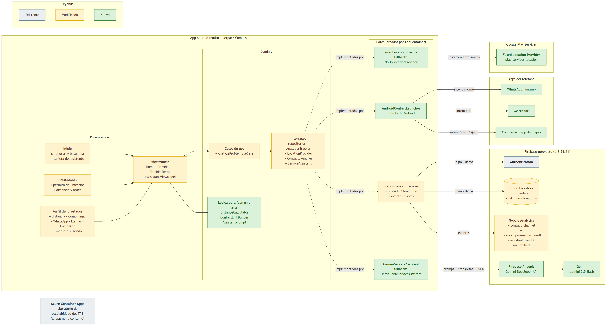

# Integración de APIs y SDKs (TP7) — ServiciosYA

> Trabajo Práctico 7 de Arquitecturas Móviles 2026. El diagrama de arquitectura actualizado está en la [sección 6 de ARQUITECTURA.md](ARQUITECTURA.md#6-arquitectura-con-integraciones-de-apis-y-sdks-tp7).

ServiciosYA ya usaba Firebase Authentication, Cloud Firestore, Google Analytics, Cloud Functions y el Admin SDK. En este TP sumamos tres integraciones nuevas, cada una elegida para atacar un hallazgo de la [prueba del TP2](RESULTADOS.md#4-hallazgos):

1. **Ubicación:** Google Play Services Location, para mostrar la distancia y ordenar por cercanía.
2. **Contacto directo:** WhatsApp (`wa.me`), llamada y compartir, con Intents de Android.
3. **Asistente con IA:** Gemini a través de Firebase AI Logic.

## 1. Lectura y análisis: beneficios y desafíos de integrar APIs y SDKs

### Beneficios para ServiciosYA

- **Velocidad de desarrollo.** Las tres funcionalidades se implementaron en pocos días. Construir un motor de ubicación o un modelo de lenguaje propio no es viable para un equipo de dos personas.
- **Funcionalidades que no conviene construir.** La ubicación y la IA son problemas resueltos por proveedores especializados, con calidad, cobertura y mantenimiento que no podríamos igualar. El equipo se concentra en lo propio: el catálogo de prestadores y el flujo de contacto.
- **Aprovechar apps que el usuario ya usa.** En Argentina, contactar a alguien es escribirle por WhatsApp. En vez de construir un chat propio, la app abre WhatsApp con el mensaje ya escrito. El usuario no aprende nada nuevo y el prestador recibe el pedido donde ya trabaja.
- **Escalabilidad y disponibilidad heredadas.** Firebase AI Logic y Play Services escalan solos, igual que Firestore en el TP3.

### Desafíos y cómo los mitigamos

| Desafío | Cómo aparece en ServiciosYA | Mitigación |
|---|---|---|
| **Permisos y privacidad** | La ubicación es un dato sensible. El texto que se envía a la IA puede contener datos personales | Solo se pide ubicación **aproximada** (`ACCESS_COARSE_LOCATION`), con un aviso previo y la opción "Ahora no". La distancia se calcula en el teléfono y a Analytics solo llega un rango (`1-3km`). A Gemini se envía solo el texto del problema y la lista de categorías: nunca el nombre, el email ni el uid |
| **Credenciales y costos** | Un servicio de IA pago podría generar costos o exponer una clave dentro del APK | Firebase AI Logic usa la configuración del proyecto de Firebase, así que la app no guarda ninguna clave propia. Se usa Gemini Developer API, que funciona en el plan gratuito (Spark) |
| **Dependencia de proveedores** | Si cambia la API de un proveedor o se retira un modelo, la app se rompe | Cada SDK está detrás de una **interfaz del dominio** (`LocationProvider`, `ContactLauncher`, `ServiceAssistant`). Cambiar de proveedor es escribir otra clase en `data/` sin tocar ViewModels ni pantallas. El nombre del modelo está en una constante |
| **Respuestas no deterministas de la IA** | Gemini puede devolver una categoría que no existe, un JSON mal formado o un mensaje demasiado largo | Salida estructurada con `responseSchema`, parseo defensivo y `AnalyzeProblemUseCase`, que descarta categorías inexistentes o inactivas y recorta el mensaje a 500 caracteres |
| **Tamaño del APK** | Cada SDK suma peso | Se usaron solo los módulos necesarios (`play-services-location` y `firebase-ai`). El contacto directo no agrega ninguna dependencia |
| **Sin conexión, sin permiso o sin configuración** | El usuario puede rechazar el permiso, no tener Play Services, o el proyecto puede no tener AI Logic habilitado | Cada integración tiene un *fallback*: `NoOpLocationProvider` y `UnavailableServiceAssistant`. La app sigue funcionando como antes, solo sin la funcionalidad nueva |

La decisión de arquitectura que hace posible todo esto es la misma del TP2: **la UI nunca usa un SDK directamente.**

## 2. Selección y justificación

| # | Integración | Tipo | Funcionalidad nueva | Hallazgo del TP2 |
|---|---|---|---|---|
| 1 | **Google Play Services Location** | SDK | Distancia a cada prestador ("a 2,3 km"), listado ordenado por cercanía y botón "Cómo llegar" | **H2**: 5 de 15 prestadores recibieron todas las solicitudes. Ordenar por cercanía reparte la demanda |
| 2 | **Contacto directo: WhatsApp (`wa.me`), llamada y compartir** | API pública de WhatsApp + Intents de Android | Botones "WhatsApp" con el mensaje ya escrito, "Llamar" y "Compartir" | **H4**: la solicitud quedaba *Pendiente* para siempre porque nadie la recibía |
| 3 | **Gemini con Firebase AI Logic** | SDK | El usuario describe su problema, la app sugiere la categoría y redacta el mensaje | **H5**: el 50 % de las solicitudes llegó sin mensaje. **H3**: búsquedas de servicios que no existen (herrero, albañil) |

Por qué estas tres y no otras:

- **Sin costo y sin plan Blaze.** El proyecto no tiene tarjeta asociada (por eso el TP3 se desplegó en Azure for Students). Gemini Developer API funciona en el plan Spark, y la ubicación de Play Services y los Intents no cuestan nada.
- **Cada una ataca un hallazgo medido**, no una idea suelta.
- **Trabajan juntas.** El asistente elige la categoría, el listado ordena por cercanía y WhatsApp lleva el mensaje redactado al prestador ([diagrama de secuencia](ARQUITECTURA.md#62-flujo-del-asistente-las-tres-integraciones-juntas)).

## 3. Implementación

Las tres siguen el mismo patrón:

1. Una interfaz en `domain/`.
2. La implementación con el SDK en `data/`.
3. Un *fallback* para cuando el SDK no está disponible.
4. La lógica pura en `domain/`, con tests unitarios.

`di/AppContainer.kt` decide qué implementación usar:

```kotlin
val serviceAssistant: ServiceAssistant = if (isFirebaseConfigured) {
    GeminiServiceAssistant.create()
} else {
    UnavailableServiceAssistant()
}

val contactLauncher: ContactLauncher = AndroidContactLauncher(context)

val locationProvider: LocationProvider =
    if (GoogleApiAvailability.getInstance().isGooglePlayServicesAvailable(context) == ConnectionResult.SUCCESS) {
        FusedLocationProvider(context, LocationServices.getFusedLocationProviderClient(context))
    } else {
        NoOpLocationProvider()
    }
```

### 3.1 Contacto directo: WhatsApp, llamada y compartir

| Capa | Archivos |
|---|---|
| Dominio | `domain/contact/ContactLinkBuilder.kt` (lógica pura), `domain/contact/ContactLauncher.kt` (interfaz) |
| Datos | `data/contact/AndroidContactLauncher.kt` |
| Presentación | `ProviderDetailViewModel.kt` (`contactByWhatsApp`, `call`, `share`) y `ProviderDetailScreen.kt` (fila de botones) |
| Analytics | Evento `contact_channel` con `channel`, `provider_id` y `category_id` |

`ContactLinkBuilder` normaliza los teléfonos argentinos al formato que espera WhatsApp, con el 9 de celular. Acepta guiones, el 0 y el 15, y el prefijo +54:

```kotlin
ContactLinkBuilder.normalizeArgentinePhone("3564-400101")       // "5493564400101"
ContactLinkBuilder.normalizeArgentinePhone("03564 15-400101")   // "5493564400101"
ContactLinkBuilder.whatsAppUrl("5493564400101", "Hola Carlos, te encontré en ServiciosYA. Necesito un enchufe")
// https://wa.me/5493564400101?text=Hola%20Carlos%2C%20te%20encontr%C3%A9%20en%20ServiciosYA.%20Necesito%20un%20enchufe
```

`AndroidContactLauncher` abre cada canal con un Intent. `ACTION_DIAL` solo abre el marcador, así que no hace falta el permiso de llamada. Si WhatsApp no está instalado, el link `wa.me` se abre en el navegador. Si ninguna app puede abrirlo, se captura `ActivityNotFoundException` y la pantalla muestra "No se pudo abrir WhatsApp". No hace falta declarar `<queries>`, porque la app no consulta qué apps hay instaladas: lanza el Intent y maneja el error.

**Decisión: tocar WhatsApp no crea una solicitud.** "Solicitar contacto" sigue siendo el registro en "Mis solicitudes" y en el embudo. WhatsApp, llamar y compartir se miden aparte con `contact_channel`, así cada canal se cuenta una sola vez y se puede comparar cuál usa la gente. Si el grupo decide lo contrario, alcanza con llamar a `requestContact` desde `contactByWhatsApp`.

### 3.2 Ubicación

| Capa | Archivos |
|---|---|
| Datos del seed | `tools/seed/seed-data.json` (`latitude` y `longitude` de los 15 prestadores) y `seed.js` (valida que sean números válidos) |
| Modelo | `Provider` y `ProviderDto` con `latitude: Double?` y `longitude: Double?`. Son nullable, así un prestador sin coordenadas no rompe la app |
| Dominio | `domain/model/GeoPoint.kt`, `domain/location/LocationProvider.kt` (interfaz), `domain/location/DistanceCalculator.kt` (haversine, orden, formato y rangos) |
| Datos | `data/location/FusedLocationProvider.kt`, `data/location/NoOpLocationProvider.kt` |
| Presentación | `ProvidersViewModel` y `ProvidersScreen` (aviso, permiso, distancia y orden). `ProviderDetailScreen` (distancia y "Cómo llegar") |
| Configuración | Permiso `ACCESS_COARSE_LOCATION` en `AndroidManifest.xml` |
| Analytics | Evento `location_permission_result` con `granted`, y `distance_bucket` en `provider_view` |

La distancia se calcula en el dominio con la fórmula de haversine. El listado se ordena de más cerca a más lejos, y los prestadores sin coordenadas van al final:

```kotlin
fun withDistances(providers: List<Provider>, origin: GeoPoint?): List<Pair<Provider, Double?>> {
    val paired = providers.map { it to distanceKm(origin, it) }
    return if (origin == null) paired else paired.sortedWith(compareBy(nullsLast()) { it.second })
}

formatDistance(0.8)   // "a 800 m"
formatDistance(2.34)  // "a 2,3 km"
distanceBucket(2.34)  // "1-3km": lo único que llega a Analytics
```

`FusedLocationProvider` verifica el permiso y pide la ubicación con `Priority.PRIORITY_BALANCED_POWER_ACCURACY`, con un límite de 10 segundos. Guarda el resultado 2 minutos, así el perfil del prestador reutiliza la ubicación que ya pidió el listado.

En el listado, si no hay permiso aparece la tarjeta "Activá la ubicación para ver los prestadores más cerca tuyo", con "Activar" y "Ahora no". Si el usuario rechaza el permiso, la app funciona igual que antes, sin distancias.

El perfil muestra la distancia y el botón "Cómo llegar", que abre la app de mapas del teléfono en la ubicación del prestador con un Intent `geo:`:

```kotlin
ContactLinkBuilder.directionsUri(GeoPoint(-31.4268, -62.0849), "Plomería García")
// geo:-31.4268,-62.0849?q=-31.4268,-62.0849(Plomer%C3%ADa%20Garc%C3%ADa)
```

### 3.3 Asistente con Gemini (Firebase AI Logic)

| Capa | Archivos |
|---|---|
| Dominio | `domain/assistant/ServiceAssistant.kt` (interfaz, `AssistantSuggestion` y `AssistantException`), `domain/assistant/AssistantPrompt.kt` (prompt y parseo del JSON), `domain/usecase/AnalyzeProblemUseCase.kt` |
| Datos | `data/assistant/GeminiServiceAssistant.kt`, `data/assistant/UnavailableServiceAssistant.kt` |
| Presentación | `presentation/assistant/AssistantViewModel.kt`, `AssistantCard.kt` (tarjeta "¿Qué necesitás resolver?" en el Inicio). `ProviderDetailViewModel.applySuggestedMessage` |
| Analytics | `assistant_used` con `result` (`matched`, `unmatched` o `error`) y `category_id`. `assistant_unmatched` con `service`. `from_assistant` en `contact_request` |

El modelo se configura con salida JSON y un esquema fijo, así la respuesta siempre tiene los tres campos esperados:

```kotlin
Firebase.ai(backend = GenerativeBackend.googleAI()).generativeModel(
    modelName = "gemini-3.5-flash",
    generationConfig = generationConfig {
        temperature = 0.2f
        responseMimeType = "application/json"
        responseSchema = Schema.obj(
            mapOf(
                "categoryId" to Schema.string(nullable = true),
                "suggestedMessage" to Schema.string(),
                "unmatchedService" to Schema.string(nullable = true),
            ),
        )
    },
    systemInstruction = content { text(AssistantPrompt.SYSTEM_INSTRUCTION) },
)
```

Elegimos `gemini-3.5-flash` porque es el modelo Flash estable con fecha de retiro más lejana (no antes de mayo de 2027) y no requiere Blaze. Las versiones 3.6 a 3.8 están marcadas como de disponibilidad corta.

El prompt de sistema le indica:

- que es el asistente de una app de servicios domiciliarios de San Francisco, Córdoba;
- que elija como máximo una categoría de la lista;
- que redacte un mensaje cordial de 1 a 3 oraciones sin inventar datos personales ni precios;
- que, si nada corresponde, devuelva la categoría en `null` y el oficio que haría falta.

`AnalyzeProblemUseCase` valida lo que entra y lo que sale:

```kotlin
val categoryId = suggestion.categoryId?.takeIf { id -> activeCategories.any { it.id == id } }
```

Si Gemini inventa un id, se trata como "sin categoría".

Según el resultado, la tarjeta muestra:

- **Con categoría:** "Te sugerimos: **Electricista**" y el botón "Ver prestadores". Al abrir un prestador de esa categoría, el mensaje sugerido aparece en el campo de mensaje, pero solo si el usuario no escribió nada.
- **Sin categoría:** "Todavía no tenemos *herrero* en ServiciosYA", y se registra `assistant_unmatched`. Así se cubren las búsquedas sin resultado de H3 sin crear colecciones nuevas en Firestore.
- **Error:** "No pudimos analizar tu consulta, elegí la categoría manualmente".

Debajo hay siempre un aviso: "Las sugerencias las genera una IA y pueden equivocarse".

El `AssistantViewModel` vive a nivel de la app, igual que `HomeViewModel`, para que el mensaje siga disponible al navegar al perfil. Se reinicia cuando cambia la sesión.

## 4. Pruebas

### 4.1 Tests unitarios

Se agregaron **60 tests** (de 77 a 137), todos con *fakes* en `app/src/test/.../testutil/` (`FakeContactLauncher`, `FakeLocationProvider` y `FakeServiceAssistant`):

| Archivo | Tests | Qué cubre |
|---|---:|---|
| `ContactLinkBuilderTest` | 9 | Teléfonos con guion, 0, 15 y +54, e inválidos. Codificación de espacios, tildes y ñ. Mensaje vacío. Texto para compartir. URI `geo:` |
| `DistanceCalculatorTest` | 9 | Mismo punto = 0. Distancias conocidas (San Francisco–Córdoba ≈ 200 km). Orden con y sin ubicación. Prestador sin coordenadas al final. Formato "a 800 m" / "a 2,3 km". Rangos para Analytics |
| `ProvidersViewModelTest` | +5 | Ordena por cercanía con ubicación. Mantiene el orden sin ubicación. Permiso concedido y rechazado (con el evento). "Ahora no" |
| `ProviderDetailViewModelTest` | +12 | Cada botón llama al launcher correcto y registra `contact_channel`. Teléfono inválido. Intent fallido. Distancia y `distance_bucket` sin coordenadas. "Cómo llegar". Mensaje sugerido y `from_assistant` |
| `ProviderDtoTest` | +1 | Mapeo de `latitude` y `longitude`, y prestador sin coordenadas |
| `AssistantPromptTest` | 7 | JSON válido, sin categoría, envuelto en un bloque de código, con campos faltantes o de tipo incorrecto, e inválido. Contenido del prompt |
| `AnalyzeProblemUseCaseTest` | 8 | Entrada vacía y demasiado larga. Solo categorías activas. Id inexistente o inactivo → `null`. Mensaje recortado. Error del asistente |
| `AssistantViewModelTest` | 9 | Estados de carga, resultado con y sin categoría, error, y los eventos de Analytics. Mensaje sugerido solo para la categoría sugerida. Reinicio |

```bash
./gradlew testDebugUnitTest   # 137 tests, 0 fallos
```

También se verificó que la app compile **sin** `google-services.json`. En ese caso usa los *fallbacks*: el asistente indica elegir la categoría manualmente y la app sigue funcionando.

### 4.2 Prueba manual

Antes de la prueba hay que completar la configuración de la [sección 5](#5-configuración-necesaria). Para la ubicación, en el emulador se usan las coordenadas de San Francisco (-31.4280, -62.0830) desde *Extended controls → Location*.

| # | Caso | Resultado esperado | Captura |
|---|---|---|---|
| 1 | Abrir una categoría sin permiso y tocar "Activar" → **Permitir** | El listado se ordena por cercanía y muestra "a X km" | `docs/screenshots/tp7-01-distancias.png` |
| 2 | Repetir y elegir **No permitir** | El listado se ve como antes, sin distancias ni errores | `docs/screenshots/tp7-02-permiso-rechazado.png` |
| 3 | Abrir un prestador y tocar "Cómo llegar" | El perfil muestra la distancia, y "Cómo llegar" abre la app de mapas en la ubicación del prestador | `docs/screenshots/tp7-03-como-llegar.png` |
| 4 | Escribir un mensaje y tocar **WhatsApp** | Se abre WhatsApp con el saludo y el mensaje | `docs/screenshots/tp7-04-whatsapp.png` |
| 5 | Asistente: "Se me cortó la luz en la cocina" | Te sugerimos: Electricista | `docs/screenshots/tp7-05-asistente-electricista.png` |
| 6 | Asistente: "Pierde agua la canilla del baño" | Te sugerimos: Plomero | `docs/screenshots/tp7-06-asistente-plomero.png` |
| 7 | Asistente: "La compu no prende" | Te sugerimos: Técnico PC | `docs/screenshots/tp7-07-asistente-tecnico-pc.png` |
| 8 | Asistente: "Necesito soldar una reja" | Todavía no tenemos herrero en ServiciosYA | `docs/screenshots/tp7-08-asistente-herrero.png` |
| 9 | Desde el caso 5, "Ver prestadores" → un prestador | El campo de mensaje ya tiene el texto sugerido | `docs/screenshots/tp7-09-mensaje-sugerido.png` |

Los teléfonos del seed son ficticios. Para probar WhatsApp de verdad, se cambia el teléfono de **un** prestador por el de un integrante del grupo directamente en la consola de Firestore, sin commitearlo.

## 5. Configuración necesaria

| Qué | Dónde | Sin esto |
|---|---|---|
| **Habilitar Firebase AI Logic** con el proveedor **Gemini Developer API** | Consola de Firebase → *AI Logic* → *Comenzar*. No requiere Blaze | El asistente responde "No pudimos analizar tu consulta, elegí la categoría manualmente" |
| **Recargar el seed** con las coordenadas | `cd tools/seed && npm run seed` | Los prestadores no tienen ubicación: no hay distancias ni "Cómo llegar" |

## 6. Diagrama de arquitectura

El diagrama completo, el flujo del asistente y la tabla "Cómo mejora cada integración la app" están en la [sección 6 de ARQUITECTURA.md](ARQUITECTURA.md#6-arquitectura-con-integraciones-de-apis-y-sdks-tp7). Las versiones en PNG para el informe están en [`docs/diagrams/tp7-arquitectura.png`](diagrams/tp7-arquitectura.png) y [`docs/diagrams/tp7-flujo-asistente.png`](diagrams/tp7-flujo-asistente.png).


