# Estrategias de retención de usuarios (TP6) — ServiciosYA

> Trabajo Práctico 6 de Arquitecturas Móviles 2026. El diagrama de arquitectura actualizado está en la [sección 9 de ARQUITECTURA.md](ARQUITECTURA.md#9-retención-de-usuarios-y-notificaciones-push-tp6).

ServiciosYA se usa cuando se rompe algo en la casa. Esa necesidad es esporádica, y el riesgo es que el usuario resuelva su problema (o no) y no vuelva a abrir la app. En la prueba del TP2 lo vimos con dos hallazgos:

- **H4:** la solicitud de contacto quedaba *Pendiente* para siempre y el usuario no tenía motivo para volver.
- **H2/H3:** el interés del usuario por ciertas categorías, y los prestadores que miraba, no se aprovechaban para traerlo de vuelta.

Diseñamos cuatro estrategias que combinan **notificaciones push**, **contenido personalizado** y **gamificación**.

## 1. Estrategias de retención

| # | Estrategia | Qué hace | Hallazgo | Métrica |
|---|---|---|---|---|
| 1 | **Campañas push por interés** | El usuario que acepta las notificaciones queda suscripto al topic `novedades` y a `categoria_<id>` por cada categoría que explora. Las campañas llegan solo a quien le interesa ese rubro y, al tocarlas, abren la categoría o el prestador | H2/H3 | `notification_open` por campaña; usuarios activos a 1 y 7 días (cohortes de retención de Analytics) |
| 2 | **Recordatorio de seguimiento** | 24 horas después de "Solicitar contacto" o de escribir por WhatsApp llega "¿Pudiste resolverlo?". Si el prestador no respondió, el usuario vuelve y contacta a otro | H4 | % de aperturas del recordatorio (`notification_open` con `type = reminder`); vuelta a la app en 48 h |
| 3 | **Contenido personalizado: "Para vos"** | El Inicio muestra los prestadores **favoritos** (botón ♡ en el perfil) y los **vistos recientemente**. Volver a contactar a alguien de confianza queda a un toque | H2 | Uso de "Para vos"; `favorite_added` |
| 4 | **Gamificación liviana: Logros** | El Perfil muestra 5 insignias y una barra de progreso: primera consulta al asistente, primer contacto, explorar 3 categorías, primer favorito y activar las notificaciones | — | `achievement_unlocked` por insignia |

**Buenas prácticas que aplicamos:**

- **Pedir el permiso en contexto.** La app no pide notificaciones al abrirse. Recién después del primer contacto aparece "¿Te avisamos si el prestador no te responde y cuando haya novedades en tus categorías?", que es cuando el usuario entiende para qué sirven. Si elige "Ahora no", no se le vuelve a preguntar, y puede activarlas en el Perfil.
- **Relevancia antes que volumen.** Las campañas se segmentan por categoría, en lugar de mandarle todo a todos.
- **Cada notificación lleva a un lugar concreto.** Toda notificación abre la pantalla relacionada, no solo la app.
- **Privacidad.** El historial y los favoritos quedan en el teléfono, separados por usuario. Ningún evento de Analytics lleva datos personales.
- **Medir cada estrategia.** Cada una tiene un evento propio para saber si funciona.

## 2. Configuración de notificaciones push

### 2.1 Firebase Cloud Messaging

FCM es gratis y funciona en el plan Spark del proyecto. Como las campañas se envían a **topics**, no hace falta guardar los tokens de los dispositivos ni tener Cloud Functions.

| Pieza | Configuración |
|---|---|
| Dependencias | `firebase-messaging` (Firebase BoM 34.19.0) y `androidx.work:work-runtime-ktx` 2.11.0 |
| Manifest | Permiso `POST_NOTIFICATIONS`, servicio `ServiciosYaMessagingService` con la acción `MESSAGING_EVENT`, y el canal (`novedades`) y el ícono (`ic_stat_notification`) por defecto para FCM. `MainActivity` usa `launchMode="singleTop"` |
| Canales | **Novedades** (campañas) y **Recordatorios** (seguimiento), creados al iniciar la app |
| Permiso | En Android 13 o superior se pide en tiempo de ejecución, después de la pregunta en contexto. En versiones anteriores está concedido por defecto |
| Topics | `novedades` y `categoria_<id>`. Los nombres se arman en `Topics.category()`, sin tildes ni caracteres que FCM no acepta |
| Deep link | Cada notificación lleva `route` (`category/<id>`, `provider/<id>` o `requests`) y `campaign_id`. `MainActivity` los lee y la navegación abre esa pantalla cuando la sesión está lista |

### 2.2 Código

Igual que en los TP anteriores, cada pieza tiene una interfaz en el dominio, la implementación en Datos y una alternativa:

| Dominio | Datos | Alternativa |
|---|---|---|
| `PushMessaging` | `FcmPushMessaging` (`subscribeToTopic` / `unsubscribeFromTopic`) | `NoOpPushMessaging`, sin Firebase |
| `ReminderScheduler` | `WorkManagerReminderScheduler` + `FollowUpReminderWorker` | No hace falta: funciona sin Firebase |
| `UserActivityStore` | `SharedPrefsUserActivityStore` | — |

`RetentionRecorder` es el único punto por el que las pantallas registran actividad:

```kotlin
suspend fun categoryViewed(categoryId: String) {
    trackingAchievements { store.addExploredCategory(categoryId) }
    if (store.snapshot().notificationsOptIn == true && push.areNotificationsEnabled()) {
        push.subscribe(Topics.category(categoryId))
    }
}

suspend fun setNotificationsEnabled(enabled: Boolean) {
    store.setNotificationsOptIn(enabled)
    val topics = listOf(Topics.NEWS) + store.snapshot().exploredCategoryIds.map(Topics::category)
    if (enabled) {
        topics.forEach { push.subscribe(it) }
        trackingAchievements { store.addMilestone(Milestone.NOTIFICATIONS_ENABLED) }
    } else {
        topics.forEach { push.unsubscribe(it) }
    }
}
```

El recordatorio se programa con WorkManager, uno por prestador. En la versión de desarrollo la espera baja a 1 minuto (`FOLLOW_UP_DELAY_MINUTES`) para poder mostrarlo en una demo:

```kotlin
val request = OneTimeWorkRequestBuilder<FollowUpReminderWorker>()
    .setInitialDelay(delayMinutes, TimeUnit.MINUTES)
    .setInputData(workDataOf(KEY_PROVIDER_ID to providerId, KEY_PROVIDER_NAME to providerName))
    .build()
WorkManager.getInstance(context).enqueueUniqueWork("follow-up-$providerId", ExistingWorkPolicy.REPLACE, request)
```

### 2.3 Crear y enviar campañas

**Con `tools/push`.** Las campañas están en `tools/push/campaigns.json`:

| Campaña | Topic | Al tocarla |
|---|---|---|
| `bienvenida-novedades` | `novedades` | Abre el Inicio |
| `electricistas-destacados` | `categoria_electricistas` | Abre la categoría Electricista |
| `reactivacion` | `novedades` | Abre el Inicio ("¿Se rompió algo en casa? Contale tu problema al asistente") |
| `plomero-recomendado` | `categoria_plomeros` | Abre el perfil de Aguas Claras Servicios |

```bash
cd tools/push
npm install
npm run check                                     # valida las campañas sin conectarse
export GOOGLE_APPLICATION_CREDENTIALS="/c/ruta/a/la-cuenta-de-servicio.json"
npm run send -- --campaign electricistas-destacados
```

El script valida cada campaña: topic, largo del texto y que la ruta tenga el formato que entiende la app. Envía con la API HTTP v1 de FCM a través del Admin SDK y manda una campaña por vez.

**Desde la consola de Firebase**, sin código: *Messaging → Nueva campaña → Notificaciones*, con destino **Tema** (por ejemplo `novedades`) y, en *Datos personalizados*, `route` y `campaign_id`. El paso a paso está en [`tools/push/README.md`](../tools/push/README.md).

## 3. Pruebas

### 3.1 Tests unitarios

Se agregaron **26 tests** (de 259 a 285, todos en verde), con fakes nuevos en `testutil/`: `FakePushMessaging`, `FakeReminderScheduler` e `InMemoryUserActivityStore`.

| Clase de test | Tests | Qué cubre |
|---|---:|---|
| `NotificationRouteTest` | 4 | Rutas válidas e inválidas (incluidas URLs externas y `../`) y nombres de topic válidos para FCM |
| `RetentionRecorderTest` | 8 | Vistos recientes (máximo 5, sin repetidos), logros que se desbloquean una sola vez, "Explorador" a la tercera categoría, suscripción a topics solo con las notificaciones aceptadas, desuscripción y favoritos |
| `RetentionViewModelTest` | 7 | "Para vos" en orden, una sola lectura del catálogo, cuándo aparece la pregunta de notificaciones, permiso concedido y rechazado, y reinicio al cambiar de usuario |
| `ProviderDetailViewModelTest` | +5 | Vistos recientes, favorito, recordatorio al solicitar contacto o abrir WhatsApp (y no si falla), logro "Primer contacto" |
| `ProvidersViewModelTest` | +1 | Categoría explorada y suscripción a su topic |
| `AssistantViewModelTest` | +1 | Logro "Primera consulta" solo con una respuesta válida |

También pasan lint, la compilación de la versión final y la de los tests instrumentados.

### 3.2 Prueba manual

En el emulador de Android Studio (API 37, con Google Play) contra el proyecto real de Firebase. Las campañas se enviaron con `tools/push` y llegaron por FCM. Todos los casos dieron el resultado esperado.

| # | Caso | Resultado | Captura |
|---|---|---|---|
| 1 | Guardar un prestador en favoritos y solicitar contacto | El ♡ queda marcado y la solicitud se envía | `tp6-01-favorito.png` |
| 2 | Volver al Inicio | Aparecen la pregunta de notificaciones (porque ya hubo un contacto) y "Para vos" con el favorito | `tp6-02-inicio-para-vos.png` |
| 3 | Inicio después de ver otros prestadores | "Vistos recientemente" muestra los últimos perfiles abiertos | `tp6-03-vistos-recientes.png` |
| 4 | Tocar "Activar" | Android pide el permiso de notificaciones | `tp6-04-permiso-notificaciones.png` |
| 5 | Esperar el recordatorio (1 minuto en desarrollo) | Llega "¿Pudiste resolverlo? Contactaste a Carlos Electricidad…" | `tp6-05-recordatorio.png` |
| 6 | Tocar el recordatorio | Abre el perfil de Carlos Electricidad | `tp6-06-recordatorio-abre-prestador.png` |
| 7 | Enviar `electricistas-destacados` con la app en segundo plano | Llega "Electricistas cerca tuyo" | `tp6-07-campana-categoria.png` |
| 8 | Tocar la campaña | Abre la categoría Electricista | `tp6-08-campana-abre-categoria.png` |
| 9 | Abrir Plomero, **cerrar la app** y enviar `plomero-recomendado` | Llega igual "Un plomero recomendado para vos" | `tp6-09-campana-app-cerrada.png` |
| 10 | Tocar la campaña | La app arranca desde cero y abre el perfil de Aguas Claras Servicios | `tp6-10-campana-abre-prestador.png` |
| 11 | Abrir el Perfil | Interruptor de notificaciones activado y Logros: 3 de 5 desbloqueados | `tp6-11-perfil-logros.png` |

| Favorito | Para vos | Vistos recientemente | Permiso |
|:---:|:---:|:---:|:---:|
| 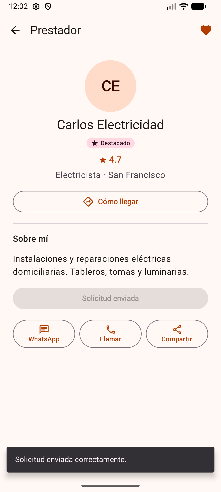 | 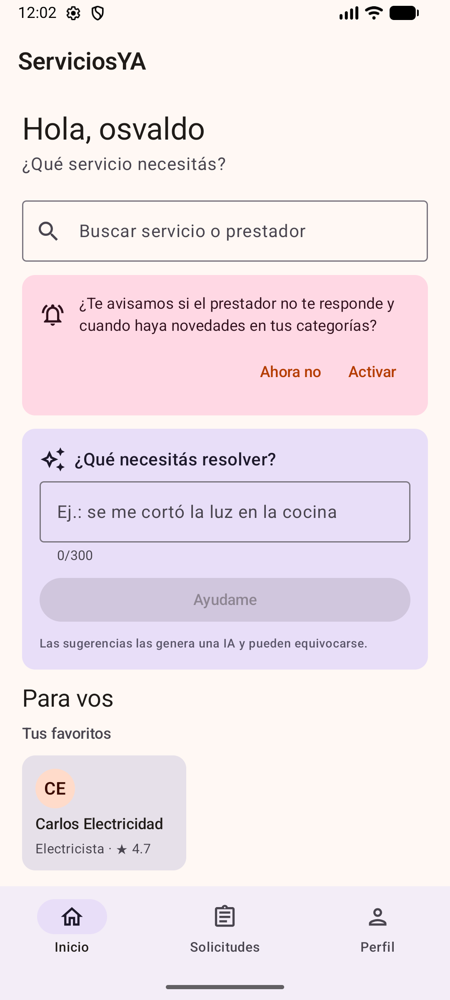 | 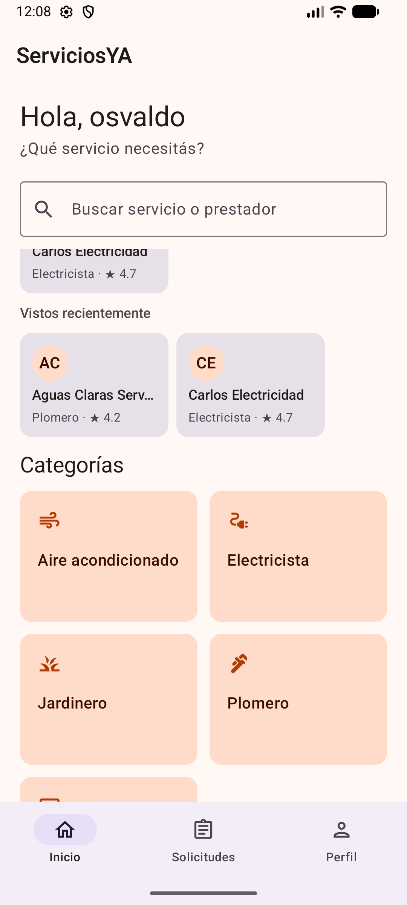 | 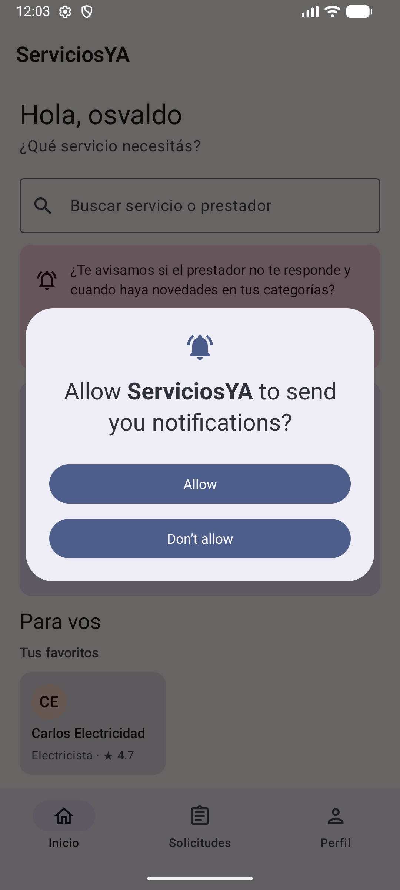 |
| **Recordatorio** | **Abre el prestador** | **Campaña** | **Abre la categoría** |
| 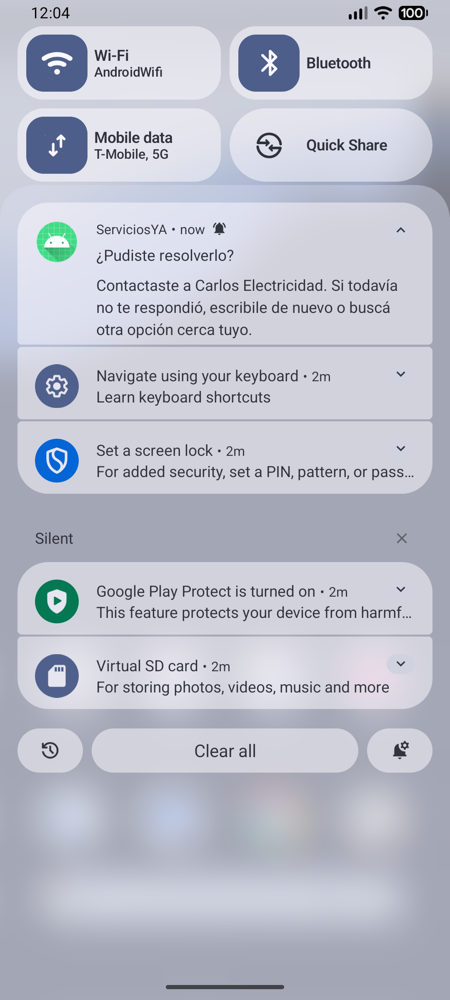 | 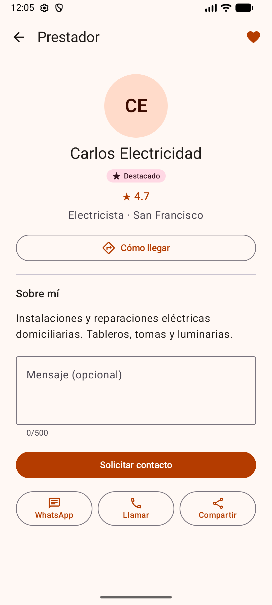 | 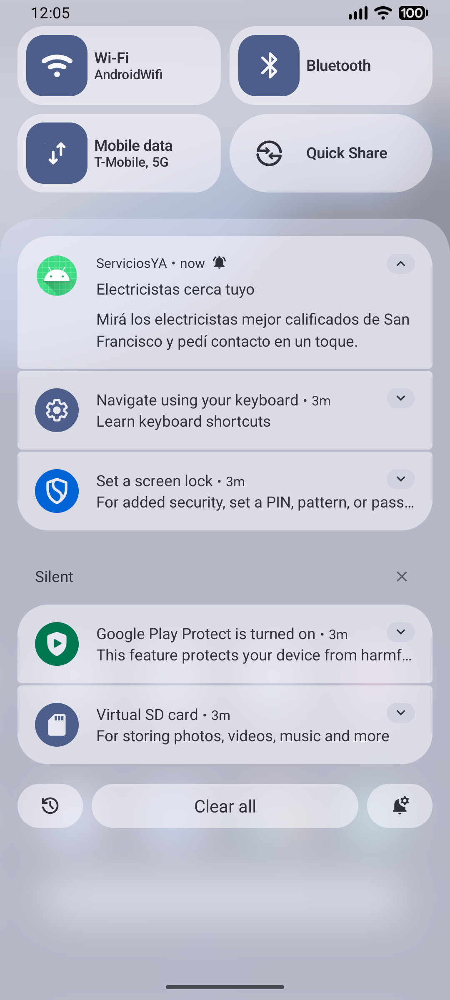 | 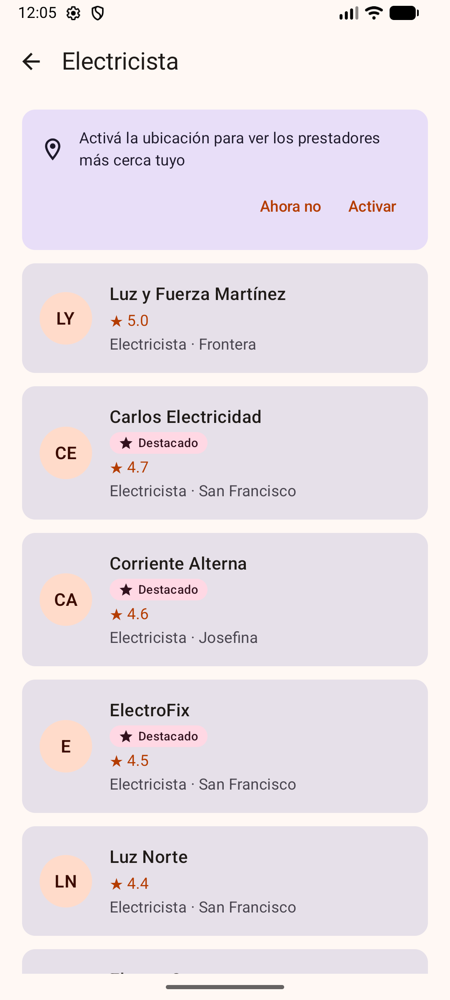 |
| **Campaña con la app cerrada** | **Abre el prestador** | **Perfil y Logros** | |
| 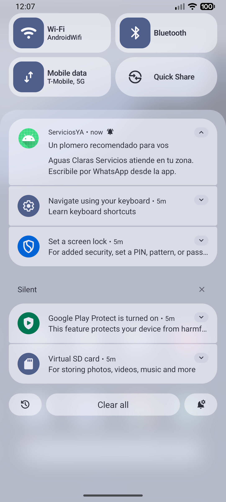 | 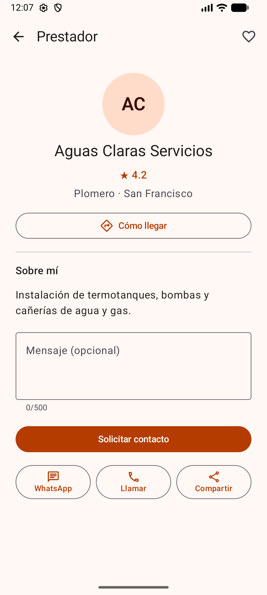 | 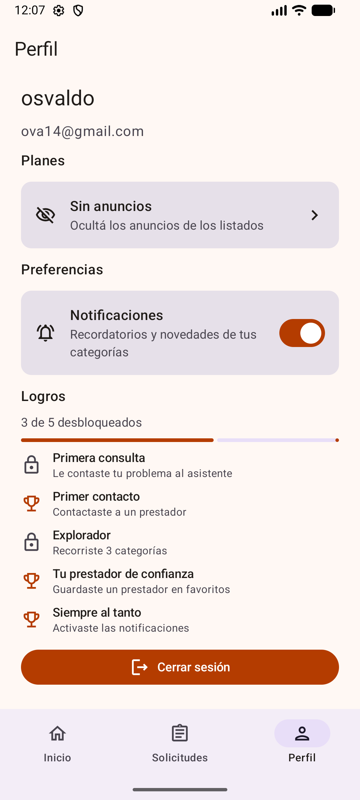 | |

## 4. Cómo se mide

Además de los eventos propios, Firebase Analytics calcula automáticamente la **retención por cohortes** (qué porcentaje de usuarios vuelve 1, 7 y 30 días después de instalar). Con los eventos nuevos se puede comparar:

- **Campañas:** `notification_open` agrupado por `campaign_id`, frente a la cantidad de dispositivos suscriptos a cada topic.
- **Recordatorio:** `notification_open` con `type = reminder`, y si después hay un nuevo `contact_request` o `contact_channel`.
- **Personalización:** `favorite_added` y las visitas a prestadores que se abren desde "Para vos".
- **Logros:** `achievement_unlocked` por insignia, para ver en qué paso se frena el usuario.
- **Permiso:** `notification_permission_result`, para saber cuántos aceptan después de la pregunta en contexto.
